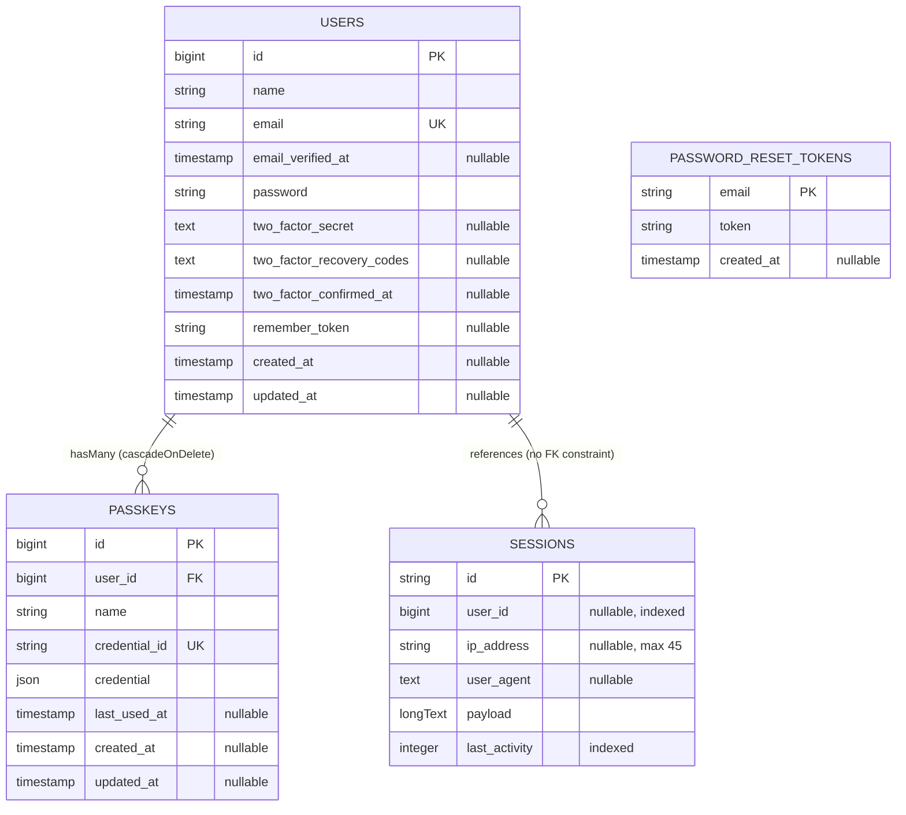
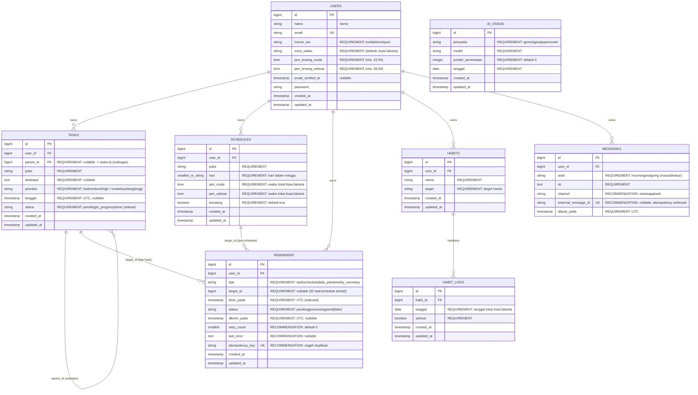

# Database Schema — Managjeh (Asisten AI Mahasiswa)

Dokumen ini memisahkan secara tegas antara **Skema Database Aktual yang Sudah Diimplementasikan (`FACT`)** berdasarkan 5 file migrasi di `database/migrations/` dan **Rancangan Skema Target Asisten AI Mahasiswa (`REQUIREMENT` / `PLANNED`)** berdasarkan Blueprint & PRD.

---

## 1. Database Engine, Timezone & Configuration (`FACT` & `REQUIREMENT`)

- **Database Engine (`FACT`):** PostgreSQL (`18.6` pada lingkungan lokal)
- **Driver Laravel (`FACT`):** `pgsql` (`ext-pdo_pgsql`, `ext-pgsql`)
- **Konfigurasi Koneksi (`config/database.php`, `.env.example`, `phpunit.xml` — `FACT`):**
  - Default connection: `pgsql` (`127.0.0.1:5432`, `search_path: public`, `charset: utf8`, `sslmode: prefer`)
  - Database Aplikasi: `managjeh`
  - Database Testing (`phpunit.xml`): `managjeh_test`
- **Aturan Penyimpanan Waktu (`FACT` + `REQUIREMENT`):**
  - `config/app.php` mengatur `'timezone' => 'UTC'` (`FACT`) dan `AppServiceProvider` mengaktifkan `Date::use(CarbonImmutable::class)` (`FACT`).
  - Seluruh kolom timestamp (`tenggat`, `kirim_pada`, `dikirim_pada`, `dibuat_pada`, `created_at`, `updated_at`) **wajib disimpan dalam UTC** dan dikonversi ke **`Asia/Jakarta`** (atau `users.zona_waktu`) saat ditampilkan maupun saat mengevaluasi batas hari/jam tenang (`REQUIREMENT`).

---

## 2. Skema Database Aktual (`FACT` — Implemented)

### 2.1 Daftar Migrasi Aktual (`database/migrations/`)

Saat ini terdapat **5 file migrasi** yang menghasilkan **10 tabel aktif**:
1. `0001_01_01_000000_create_users_table.php` — membuat tabel `users`, `password_reset_tokens`, `sessions`
2. `0001_01_01_000001_create_cache_table.php` — membuat tabel `cache`, `cache_locks`
3. `0001_01_01_000002_create_jobs_table.php` — membuat tabel `jobs`, `job_batches`, `failed_jobs`
4. `2024_01_01_000000_create_passkeys_table.php` — membuat tabel `passkeys`
5. `2025_08_14_170933_add_two_factor_columns_to_users_table.php` — menambahkan kolom 2FA pada tabel `users`

### 2.2 ERD Aktual (`FACT`)

### 2.3 Detail Tabel Aktual (`FACT`)

- **`users`:** `id` (PK), `name`, `email` (`UNIQUE`), `email_verified_at` (`nullable`), `password`, `two_factor_secret` (`nullable`), `two_factor_recovery_codes` (`nullable`), `two_factor_confirmed_at` (`nullable`), `remember_token` (`nullable`), `created_at`, `updated_at`. *(Belum memiliki kolom `nomor_wa`, `zona_waktu`, `jam_tenang_mulai`, `jam_tenang_selesai`.)*
- **`passkeys`:** `id` (PK), `user_id` (FK -> `users.id` `cascadeOnDelete`), `name`, `credential_id` (`UNIQUE`), `credential` (`json`), `last_used_at` (`nullable`), `created_at`, `updated_at`.
- **`password_reset_tokens`:** `email` (PK), `token`, `created_at` (`nullable`).
- **`sessions`:** `id` (PK), `user_id` (`nullable`, indexed), `ip_address`, `user_agent`, `payload`, `last_activity` (indexed).
- **`cache` & `cache_locks`:** Penyimpanan cache dan distributed lock berbasis database (`CACHE_STORE=database`).
- **`jobs`, `job_batches`, `failed_jobs`:** Penyimpanan antrean Laravel Queue (`QUEUE_CONNECTION=database`).

### 2.4 Models, Factories & Seeders Aktual (`FACT`)

- **Model (`app/Models/User.php`):**Satu-satunya model domain di `app/Models/` saat ini. Mengimplementasikan `MustVerifyEmail` dan `PasskeyUser`; memakai trait `HasFactory`, `Notifiable`, `PasskeyAuthenticatable`, `TwoFactorAuthenticatable`; `#[Fillable(['name', 'email', 'password'])]`.
- **Factory (`database/factories/UserFactory.php`):** Menyediakan state `unverified()` dan `withTwoFactor()`.
- **Seeder (`database/seeders/DatabaseSeeder.php`):** Membuat 1 akun contoh (`Test User`, `test@example.com`).

---

## 3. Rancangan Skema Target Asisten AI Mahasiswa (`REQUIREMENT` / `PLANNED`)

> **Status:** Seluruh perubahan kolom dan tabel di bagian ini berstatus **`Not Implemented` (`Planned`)** dan belum ada di `database/migrations/`.

### 3.1 ERD Target (`REQUIREMENT` + `RECOMMENDATION`)

### 3.2 Evaluasi Detail Entitas Target (`REQUIREMENT` & `RECOMMENDATION`)

#### 1. Tabel `users` (Perluasan dari Tabel Aktual — Minggu 1)
- **Status:** `Partially Implemented` (tabel dasar sudah ada; kolom preferensi asisten belum ada).
- **Kolom Tambahan (`REQUIREMENT`):**
  - `nama` -> sudah terwakili oleh kolom `name` (`varchar(255)`) pada migrasi bawaan Laravel (`FACT`). *Rekomendasi:* pertahankan `name` agar kompatibel dengan Fortify & komponen React yang sudah ada, atau sediakan accessor bila diperlukan.
  - `nomor_wa` (`varchar(30)`, `nullable`, indexed) — nomor WhatsApp pengguna dalam format internasional terstandarisasi (mis. `62812...`) untuk pengiriman pengingat dan pencocokan pengirim webhook (`F3`, `F4`).
  - `zona_waktu` (`varchar(64)`, default `'Asia/Jakarta'`) — zona waktu tampilan dan evaluasi jadwal pengguna (`REQUIREMENT`).
  - `jam_tenang_mulai` (`time`, `nullable`, mis. `'22:00:00'`) — batas awal jam tenang (`F5`).
  - `jam_tenang_selesai` (`time`, `nullable`, mis. `'06:00:00'`) — batas akhir jam tenang (`F5`).

#### 2. Tabel `tasks` (Minggu 1 — `F1`, `F10`)
- **Status:** `Not Implemented` (`Planned`).
- **Kolom Utama (`REQUIREMENT`):**
  - `id` (`bigint`, PK)
  - `user_id` (`bigint`, FK -> `users.id` `cascadeOnDelete`)
  - `judul` (`varchar(255)`)
  - `deskripsi` (`text`, `nullable`)
  - `prioritas` (`varchar(20)`) — tingkat prioritas (mis. `rendah`/`sedang`/`tinggi` atau `low`/`medium`/`high`).
  - `tenggat` (`timestamp`, `nullable`, disimpan dalam **UTC**) — batas waktu penyelesaian tugas.
  - `status` (`varchar(20)`) — status penyelesaian (mis. `pending`, `in_progress`, `selesai`/`done`).
  - `parent_id` (`bigint`, `nullable`, FK self-referencing -> `tasks.id` `cascadeOnDelete`) — menghubungkan subtugas ke tugas induknya (digunakan juga oleh fitur Pemecah Tugas AI `F10`).
  - `created_at`, `updated_at` (`timestamp`, UTC).
- **Index yang Direkomendasikan (`RECOMMENDATION`):** Composite index pada `(user_id, status, tenggat)` untuk mempercepat query beranda `"Hari ini"` (`F6`) dan index pada `parent_id`.

#### 3. Tabel `schedules` (Minggu 1 — `F2`)
- **Status:** `Not Implemented` (`Planned`).
- **Kolom Utama (`REQUIREMENT`):**
  - `id` (`bigint`, PK)
  - `user_id` (`bigint`, FK -> `users.id` `cascadeOnDelete`)
  - `judul` (`varchar(255)`) — nama mata kuliah atau kegiatan rutin.
  - `hari` (`smallint` `0–6` atau `varchar(15)` `senin`–`minggu`) — hari pelaksanaan dalam seminggu.
  - `jam_mulai` (`time`) — waktu mulai kegiatan dalam zona waktu lokal pengguna (`Asia/Jakarta`).
  - `jam_selesai` (`time`) — waktu selesai kegiatan.
  - `berulang` (`boolean`, default `true`) — menandakan jadwal berulang setiap minggu.
  - `created_at`, `updated_at` (`timestamp`, UTC).
- **Index yang Direkomendasikan (`RECOMMENDATION`):** Index pada `(user_id, hari, jam_mulai)`.

#### 4. Tabel `reminders` (Minggu 2 — `F3`, `F4`, `F5`)
- **Status:** `Not Implemented` (`Planned`).
- **Kolom Utama (`REQUIREMENT`):**
  - `id` (`bigint`, PK)
  - `user_id` (`bigint`, FK -> `users.id` `cascadeOnDelete`)
  - `tipe` (`varchar(30)`) — jenis sumber pengingat (mis. `task`, `schedule`, `daily_plan`, `weekly_summary`).
  - `target_id` (`bigint`, `nullable`) — ID referensi polimorfik/logis ke `tasks.id` atau `schedules.id` terkait.
  - `kirim_pada` (`timestamp`, **UTC**) — jadwal waktu pengiriman pengingat.
  - `status` (`varchar(20)`) — siklus hidup pengiriman:
    - `pending` (`REQUIREMENT`): menunggu waktu `kirim_pada`.
    - `processing` (`RECOMMENDATION`): sedang dikunci Scheduler / berada di Queue agar tidak diambil ganda pada menit berikutnya.
    - `sent` / `terkirim` (`REQUIREMENT`): berhasil dikirim lewat gateway WhatsApp.
    - `failed` / `gagal` (`REQUIREMENT`): gagal setelah seluruh retry habis (ditampilkan di beranda `"Hari ini"`).
  - `dikirim_pada` (`timestamp`, `nullable`, **UTC**) — waktu aktual pesan berhasil dikirim.
- **Kolom Tambahan untuk Keandalan (`RECOMMENDATION`):**
  - `retry_count` (`smallint`, default `0`) & `last_error` (`text`, `nullable`) — untuk melacak jumlah percobaan ulang dan pesan error terakhir dari gateway WhatsApp.
  - `idempotency_key` (`varchar(100)`, `nullable`, `UNIQUE`) — misalnya kombinasi `"{tipe}:{target_id}:{kirim_pada_utc}"` untuk mencegah pembuatan/pengiriman pengingat duplikat.
- **Index yang Direkomendasikan (`RECOMMENDATION`):** Composite index pada `(status, kirim_pada)` karena di-query oleh Laravel Scheduler setiap menit, serta index pada `(tipe, target_id)`.

#### 5. Tabel `habits` & `habit_logs` (Minggu 6 — `F11`)
- **Status:** `Not Implemented` (`Planned`).
- **Kolom `habits` (`REQUIREMENT`):**
  - `id` (`bigint`, PK), `user_id` (FK -> `users.id`), `nama` (`varchar(255)`), `target` (`varchar(100)` atau `integer`), `created_at`, `updated_at`.
- **Kolom `habit_logs` (`REQUIREMENT`):**
  - `id` (`bigint`, PK), `habit_id` (FK -> `habits.id` `cascadeOnDelete`), `tanggal` (`date`), `selesai` (`boolean`, default `false`), `created_at`, `updated_at`.
  - **Constraint (`RECOMMENDATION`):** Unique constraint pada `(habit_id, tanggal)` agar satu kebiasaan hanya memiliki satu catatan per tanggal kalender (`Asia/Jakarta`).

#### 6. Tabel `messages` (Minggu 5 — `F4`, `F9`)
- **Status:** `Not Implemented` (`Planned`).
- **Kolom Utama (`REQUIREMENT`):**
  - `id` (`bigint`, PK)
  - `user_id` (`bigint`, FK -> `users.id` `cascadeOnDelete`)
  - `arah` (`varchar(20)`) — arah pesan (`incoming`/`masuk` dari pengguna atau `outgoing`/`keluar` dari asisten).
  - `isi` (`text`) — isi teks pesan WhatsApp atau obrolan AI.
  - `dibuat_pada` (`timestamp`, **UTC**).
- **Kolom Tambahan untuk Idempotency (`RECOMMENDATION`):**
  - `external_message_id` (`varchar(128)`, `nullable`, `UNIQUE`) — menyimpan ID pesan dari gateway WhatsApp agar jika gateway mengirim ulang webhook yang sama (*webhook retry*), sistem tidak memproses perintah `"selesai"`/`"tunda"` atau memanggil AI dua kali.
  - `channel` (`varchar(20)`, default `'whatsapp'`) — membedakan riwayat pesan dari WhatsApp vs UI web chat.

#### 7. Tabel `ai_usage` (Minggu 4 — `F8`)
- **Status:** `Not Implemented` (`Planned`).
- **Kolom Utama (`REQUIREMENT`):**
  - `id` (`bigint`, PK)
  - `penyedia` (`varchar(30)`) — nama provider AI (`gemini`, `groq`, `openrouter`).
  - `model` (`varchar(100)`) — identifier model yang dipanggil.
  - `jumlah_permintaan` (`integer`, default `0`) — akumulasi request pada tanggal tersebut.
  - `tanggal` (`date`) — tanggal pencatatan kuota.
  - `created_at`, `updated_at` (`timestamp`, UTC).
- **Constraint (`RECOMMENDATION`):** Unique index pada `(penyedia, model, tanggal)` sehingga pembaruan kuota harian dapat dilakukan secara atomik menggunakan `upsert` / `increment('jumlah_permintaan')`.

---

## 4. Evaluasi Kebutuhan Khusus Database (`REQUIREMENT` & `RECOMMENDATION`)

1. **Relasi Tugas dan Subtugas (`parent_id`):**
   - Diimplementasikan melalui self-referencing foreign key `tasks.parent_id -> tasks.id` (`nullable`, `cascadeOnDelete()`).
   - Model `Task` memiliki relasi `parent(): BelongsTo` dan `subtasks(): HasMany`.
2. **Relasi Pengingat terhadap Objek Terkait (`tipe` + `target_id`):**
   - Menggunakan pasangan kolom `tipe` dan `target_id` pada tabel `reminders`.
   - Saat sebuah `Task` ditandai selesai (baik lewat web maupun balasan WhatsApp `"selesai"`), seluruh `reminders` dengan `tipe = 'task'`, `target_id = $task->id`, dan `status = 'pending'` harus dibatalkan atau ditandai selesai agar tidak mengirim pengingat basi.
3. **Retry, Error Tracking & Idempotency:**
   - Tabel `jobs` dan `failed_jobs` bawaan Laravel (`FACT`) menangani antrean level infrastruktur, sedangkan status level domain (`pending`, `processing`, `sent`, `failed`) disimpan di tabel `reminders` agar pengguna dapat melihat pengingat yang gagal langsung di Beranda `"Hari ini"`.

---

## 5. TODO

- [ ] Menentukan apakah penamaan kolom fisik pada migrasi baru akan menggunakan Bahasa Indonesia persis seperti tabel ringkasan Blueprint (`judul`, `tenggat`, `kirim_pada`) atau Bahasa Inggris standar konvensi Laravel (`title`, `due_at`, `send_at`) sebelum migrasi Minggu 1 dibuat.
- [ ] Menentukan nilai default `jam_tenang_mulai` dan `jam_tenang_selesai` pada migrasi kolom tambahan tabel `users`.
