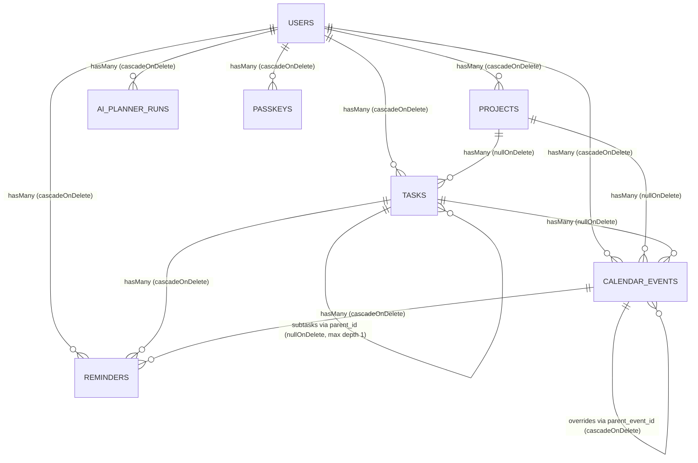

# Database Schema — Managjeh (Personal OS Mahasiswa — MVP 1)

Dokumen ini mendokumentasikan skema database **PostgreSQL** (`managjeh` & `managjeh_test`) yang **telah diimplementasikan dan terverifikasi penuh (`Implemented & Verified`)** melalui **12 file migrasi aktif** di `database/migrations/`.

Seluruh nama tabel dan kolom menggunakan **Bahasa Inggris `snake_case`**.

---

## 1. Konfigurasi Database & Aturan Waktu (`FACT`)

- **Engine:** PostgreSQL (`DB_CONNECTION=pgsql`)
- **Database Aplikasi:** `managjeh`
- **Database Testing ([phpunit.xml](../phpunit.xml)):** `managjeh_test`
- **Penyimpanan Waktu:**
    - `config('app.timezone') === 'UTC'` dan `Date::use(CarbonImmutable::class)` aktif di [AppServiceProvider.php](../app/Providers/AppServiceProvider.php).
    - Semua kolom `timestamp` (`due_at`, `completed_at`, `starts_at`, `ends_at`, `scheduled_at`, `sent_at`, `failed_at`, `whatsapp_verified_at`, `email_verified_at`, `two_factor_confirmed_at`, `created_at`, `updated_at`, `deleted_at`) disimpan dalam **UTC**.
    - Semua kolom `date` (`start_date`, `due_date`, `end_date`, `recurrence_until`, `planning_date`) disimpan sebagai tanggal kalender lokal pengguna (`Y-m-d`).
    - Semua kolom `time` (`reminder_quiet_start`, `reminder_quiet_end`) merepresentasikan jam lokal dalam zona waktu `users.timezone`.

---

## 2. Daftar 12 Migrasi Aktif (`database/migrations/`)

1. `0001_01_01_000000_create_users_table.php` — Membuat tabel `users`, `password_reset_tokens`, dan `sessions`.
2. `0001_01_01_000001_create_cache_table.php` — Membuat tabel `cache` dan `cache_locks` (digunakan juga untuk OTP hash WhatsApp, rate limiter, dan circuit breaker AI).
3. `0001_01_01_000002_create_jobs_table.php` — Membuat tabel `jobs`, `job_batches`, dan `failed_jobs` (digunakan oleh `SendWhatsAppMessageJob`).
4. `2024_01_01_000000_create_passkeys_table.php` — Membuat tabel `passkeys` untuk autentikasi WebAuthn.
5. `2025_08_14_170933_add_two_factor_columns_to_users_table.php` — Menambahkan kolom 2FA TOTP ke `users`.
6. `2026_11_15_000001_add_preferences_to_users_table.php` — Menambahkan kolom `timezone`, `whatsapp_number`, `whatsapp_verified_at`, `whatsapp_enabled`, `reminder_quiet_start`, dan `reminder_quiet_end` ke `users`.
7. `2026_11_15_000002_create_projects_table.php` — Membuat tabel `projects`.
8. `2026_11_15_000003_create_tasks_table.php` — Membuat tabel `tasks`.
9. `2026_11_15_000004_create_calendar_events_table.php` — Membuat tabel `calendar_events`.
10. `2026_11_15_000005_create_reminders_table.php` — Membuat tabel `reminders`.
11. `2026_11_15_000006_create_ai_planner_runs_table.php` — Membuat tabel `ai_planner_runs`.
12. `2026_11_16_000007_add_performance_indexes.php` — Menambahkan indeks FK dan indeks komposit query untuk `tasks`, `calendar_events`, dan `reminders`.

---

## 3. Spesifikasi Tabel Domain (`Implemented & Verified`)

### 3.1 Tabel `users`

Model: [app/Models/User.php](../app/Models/User.php)

| Kolom                       | Tipe PostgreSQL         | Nullable | Default          | Keterangan                                            |
| :-------------------------- | :---------------------- | :------- | :--------------- | :---------------------------------------------------- |
| `id`                        | `bigint` (PK)           | Tidak    | Auto             | ID pengguna                                           |
| `name`                      | `varchar(255)`          | Tidak    | —                | Nama lengkap                                          |
| `email`                     | `varchar(255)` (UNIQUE) | Tidak    | —                | Email login (disimpan huruf kecil)                    |
| `email_verified_at`         | `timestamp`             | Ya       | `null`           | Waktu verifikasi email (UTC)                          |
| `password`                  | `varchar(255)`          | Tidak    | —                | Hash bcrypt password                                  |
| `two_factor_secret`         | `text`                  | Ya       | `null`           | Secret TOTP 2FA terenkripsi                           |
| `two_factor_recovery_codes` | `text`                  | Ya       | `null`           | Recovery codes 2FA terenkripsi                        |
| `two_factor_confirmed_at`   | `timestamp`             | Ya       | `null`           | Waktu aktivasi 2FA (UTC)                              |
| `remember_token`            | `varchar(100)`          | Ya       | `null`           | Token sesi remember me                                |
| `timezone`                  | `varchar(64)`           | Tidak    | `'Asia/Jakarta'` | IANA timezone pengguna                                |
| `whatsapp_number`           | `varchar(32)` (INDEX)   | Ya       | `null`           | Nomor WA format internasional (mis. `+6281234567890`) |
| `whatsapp_verified_at`      | `timestamp`             | Ya       | `null`           | Waktu nomor WA terverifikasi OTP (`D-14`)             |
| `whatsapp_enabled`          | `boolean`               | Tidak    | `false`          | Persetujuan penerimaan pengingat WA                   |
| `reminder_quiet_start`      | `time`                  | Ya       | `'00:00:00'`     | Awal jam tenang lokal (`D-06`)                        |
| `reminder_quiet_end`        | `time`                  | Ya       | `'05:00:00'`     | Akhir jam tenang lokal (`D-06`)                       |
| `created_at`                | `timestamp`             | Ya       | `null`           | UTC                                                   |
| `updated_at`                | `timestamp`             | Ya       | `null`           | UTC                                                   |

---

### 3.2 Tabel `projects`

Model: [app/Models/Project.php](../app/Models/Project.php) | Enum: [app/Enums/ProjectStatus.php](../app/Enums/ProjectStatus.php) (`active`, `completed`, `archived`)

| Kolom          | Tipe PostgreSQL             | Nullable | Default    | Keterangan                                      |
| :------------- | :-------------------------- | :------- | :--------- | :---------------------------------------------- |
| `id`           | `bigint` (PK)               | Tidak    | Auto       | ID proyek                                       |
| `user_id`      | `bigint` (FK -> `users.id`) | Tidak    | —          | `cascadeOnDelete()`                             |
| `name`         | `varchar(150)`              | Tidak    | —          | Nama proyek                                     |
| `description`  | `text`                      | Ya       | `null`     | Deskripsi proyek                                |
| `status`       | `varchar(20)`               | Tidak    | `'active'` | `active` / `completed` / `archived`             |
| `start_date`   | `date`                      | Ya       | `null`     | Tanggal mulai (`Y-m-d`)                         |
| `due_date`     | `date`                      | Ya       | `null`     | Target selesai (`Y-m-d`)                        |
| `completed_at` | `timestamp`                 | Ya       | `null`     | Otomatis terisi saat `status = completed` (UTC) |
| `created_at`   | `timestamp`                 | Ya       | `null`     | UTC                                             |
| `updated_at`   | `timestamp`                 | Ya       | `null`     | UTC                                             |
| `deleted_at`   | `timestamp`                 | Ya       | `null`     | Soft delete (`D-11`)                            |

- **Indexes:** `(user_id, status)`, `(user_id, due_date)`.

---

### 3.3 Tabel `tasks`

Model: [app/Models/Task.php](../app/Models/Task.php) | Enums: [app/Enums/TaskStatus.php](../app/Enums/TaskStatus.php) (`todo`, `in_progress`, `completed`, `cancelled`), [app/Enums/TaskPriority.php](../app/Enums/TaskPriority.php) (`low`, `medium`, `high`, `urgent`)

| Kolom          | Tipe PostgreSQL                | Nullable | Default    | Keterangan                                         |
| :------------- | :----------------------------- | :------- | :--------- | :------------------------------------------------- |
| `id`           | `bigint` (PK)                  | Tidak    | Auto       | ID tugas                                           |
| `user_id`      | `bigint` (FK -> `users.id`)    | Tidak    | —          | `cascadeOnDelete()`                                |
| `project_id`   | `bigint` (FK -> `projects.id`) | Ya       | `null`     | `nullOnDelete()` — wajib milik `user_id` yang sama |
| `parent_id`    | `bigint` (FK -> `tasks.id`)    | Ya       | `null`     | `nullOnDelete()` — subtugas maks. 1 level (`D-09`) |
| `title`        | `varchar(200)`                 | Tidak    | —          | Judul tugas                                        |
| `description`  | `text`                         | Ya       | `null`     | Deskripsi tugas                                    |
| `status`       | `varchar(20)`                  | Tidak    | `'todo'`   | `todo` / `in_progress` / `completed` / `cancelled` |
| `priority`     | `varchar(20)`                  | Tidak    | `'medium'` | `low` / `medium` / `high` / `urgent`               |
| `due_at`       | `timestamp`                    | Ya       | `null`     | Deadline absolut dalam **UTC**                     |
| `completed_at` | `timestamp`                    | Ya       | `null`     | Otomatis terisi saat `status = completed` (UTC)    |
| `sort_order`   | `integer`                      | Tidak    | `0`        | Urutan tampilan                                    |
| `created_at`   | `timestamp`                    | Ya       | `null`     | UTC                                                |
| `updated_at`   | `timestamp`                    | Ya       | `null`     | UTC                                                |
| `deleted_at`   | `timestamp`                    | Ya       | `null`     | Soft delete (`D-11`)                               |

- **Indexes:** `(user_id, status)`, `(user_id, due_at)`, `(project_id, status)`, `(user_id, priority)`, `(parent_id)`, `(user_id, parent_id, status, due_at)`, `(user_id, status, completed_at)`.

---

### 3.4 Tabel `calendar_events`

Model: [app/Models/CalendarEvent.php](../app/Models/CalendarEvent.php)

| Kolom                   | Tipe PostgreSQL                       | Nullable | Default | Keterangan                                                                                   |
| :---------------------- | :------------------------------------ | :------- | :------ | :------------------------------------------------------------------------------------------- |
| `id`                    | `bigint` (PK)                         | Tidak    | Auto    | ID agenda                                                                                    |
| `user_id`               | `bigint` (FK -> `users.id`)           | Tidak    | —       | `cascadeOnDelete()`                                                                          |
| `project_id`            | `bigint` (FK -> `projects.id`)        | Ya       | `null`  | `nullOnDelete()` — wajib milik `user_id` yang sama                                           |
| `task_id`               | `bigint` (FK -> `tasks.id`)           | Ya       | `null`  | `nullOnDelete()` — wajib milik `user_id` yang sama                                           |
| `parent_event_id`       | `bigint` (FK -> `calendar_events.id`) | Ya       | `null`  | `cascadeOnDelete()` — diisi untuk _single-occurrence override_ dari agenda berulang (`D-08`) |
| `recurrence_id`         | `varchar(64)`                         | Ya       | `null`  | Identifier tanggal kejadian asli yang di-override (`YYYY-MM-DD`, `D-08`)                     |
| `title`                 | `varchar(200)`                        | Tidak    | —       | Judul agenda                                                                                 |
| `description`           | `text`                                | Ya       | `null`  | Deskripsi agenda                                                                             |
| `starts_at`             | `timestamp`                           | Ya       | `null`  | Waktu mulai UTC (wajib jika `is_all_day = false`, `null` jika `is_all_day = true`)           |
| `ends_at`               | `timestamp`                           | Ya       | `null`  | Waktu selesai UTC (`ends_at > starts_at` jika `is_all_day = false`)                          |
| `start_date`            | `date`                                | Ya       | `null`  | Tanggal awal lokal (wajib jika `is_all_day = true`, `null` jika `is_all_day = false`)        |
| `end_date`              | `date`                                | Ya       | `null`  | Tanggal akhir lokal (`end_date >= start_date` jika `is_all_day = true`)                      |
| `is_all_day`            | `boolean`                             | Tidak    | `false` | Penanda agenda sepanjang hari                                                                |
| `is_cancelled`          | `boolean`                             | Tidak    | `false` | Penanda jika kejadian tunggal dibatalkan (`D-08`)                                            |
| `recurrence_rule`       | `varchar(255)`                        | Ya       | `null`  | Aturan pengulangan (`FREQ=DAILY`, `FREQ=WEEKLY`, `FREQ=MONTHLY`, dll.) (`D-08`)              |
| `recurrence_until`      | `date`                                | Ya       | `null`  | Batas akhir pengulangan tanggal lokal (`D-08`)                                               |
| `recurrence_exceptions` | `jsonb`                               | Ya       | `null`  | Array tanggal kejadian yang dikecualikan dari rangkaian, mis. `["2026-11-25"]` (`D-08`)      |
| `created_at`            | `timestamp`                           | Ya       | `null`  | UTC                                                                                          |
| `updated_at`            | `timestamp`                           | Ya       | `null`  | UTC                                                                                          |
| `deleted_at`            | `timestamp`                           | Ya       | `null`  | Soft delete (`D-11`)                                                                         |

- **Indexes:** `(user_id, starts_at, ends_at)`, `(user_id, start_date, end_date)`, `(parent_event_id, recurrence_id)`, `(project_id)`, `(task_id)`, `(user_id, parent_event_id)`.

---

### 3.5 Tabel `reminders`

Model: [app/Models/Reminder.php](../app/Models/Reminder.php) | Enum: [app/Enums/ReminderStatus.php](../app/Enums/ReminderStatus.php) (`pending`, `processing`, `sent`, `failed`, `cancelled`)

| Kolom                 | Tipe PostgreSQL                       | Nullable | Default      | Keterangan                                                                            |
| :-------------------- | :------------------------------------ | :------- | :----------- | :------------------------------------------------------------------------------------ |
| `id`                  | `bigint` (PK)                         | Tidak    | Auto         | ID reminder                                                                           |
| `user_id`             | `bigint` (FK -> `users.id`)           | Tidak    | —            | `cascadeOnDelete()`                                                                   |
| `task_id`             | `bigint` (FK -> `tasks.id`)           | Ya       | `null`       | `cascadeOnDelete()` — tugas terkait                                                   |
| `calendar_event_id`   | `bigint` (FK -> `calendar_events.id`) | Ya       | `null`       | `cascadeOnDelete()` — agenda terkait                                                  |
| `channel`             | `varchar(20)`                         | Tidak    | `'whatsapp'` | Kanal notifikasi (`whatsapp`)                                                         |
| `reminder_type`       | `varchar(40)`                         | Tidak    | `'custom'`   | `before_24h`, `before_1h`, `event_start`, `ai_recommended`, `custom` (`D-05`, `D-07`) |
| `scheduled_at`        | `timestamp`                           | Tidak    | —            | Waktu pengiriman dalam **UTC** (setelah evaluasi `QuietHoursAdjuster`)                |
| `status`              | `varchar(20)`                         | Tidak    | `'pending'`  | `pending` / `processing` / `sent` / `failed` / `cancelled`                            |
| `message`             | `text`                                | Tidak    | —            | Konten pesan pengingat                                                                |
| `provider_message_id` | `varchar(150)`                        | Ya       | `null`       | ID pesan dari gateway WhatsApp                                                        |
| `sent_at`             | `timestamp`                           | Ya       | `null`       | Waktu berhasil dikirim (UTC)                                                          |
| `failed_at`           | `timestamp`                           | Ya       | `null`       | Waktu gagal dikirim (UTC)                                                             |
| `failure_reason`      | `text`                                | Ya       | `null`       | Ringkasan error aman (tanpa kredensial `D-15`)                                        |
| `idempotency_key`     | `varchar(100)` (UNIQUE)               | Tidak    | —            | Kunci unik pengiriman (`task:...`, `event:...`, `ai_rec:...`)                         |
| `created_at`          | `timestamp`                           | Ya       | `null`       | UTC                                                                                   |
| `updated_at`          | `timestamp`                           | Ya       | `null`       | UTC                                                                                   |

- **Indexes:** `(status, scheduled_at)`, `(user_id, status)`, `(task_id)`, `(calendar_event_id)`, unique index pada `idempotency_key`.

---

### 3.6 Tabel `ai_planner_runs`

Model: [app/Models/AiPlannerRun.php](../app/Models/AiPlannerRun.php) | Enum: [app/Enums/AiPlannerRunStatus.php](../app/Enums/AiPlannerRunStatus.php) (`pending`, `success`, `failed`)

| Kolom            | Tipe PostgreSQL             | Nullable | Default     | Keterangan                                                                            |
| :--------------- | :-------------------------- | :------- | :---------- | :------------------------------------------------------------------------------------ |
| `id`             | `bigint` (PK)               | Tidak    | Auto        | ID eksekusi planner                                                                   |
| `user_id`        | `bigint` (FK -> `users.id`) | Tidak    | —           | `cascadeOnDelete()`                                                                   |
| `planning_date`  | `date`                      | Tidak    | —           | Tanggal rencana berdasarkan `users.timezone` (`Y-m-d`)                                |
| `trigger_type`   | `varchar(30)`               | Tidak    | `'manual'`  | `manual` / `scheduled` / `data_change` (`D-12`)                                       |
| `provider`       | `varchar(50)`               | Tidak    | —           | `gemini` / `grok` / `openrouter` / `fallback` (`D-03`)                                |
| `model`          | `varchar(100)`              | Ya       | `null`      | Nama model yang digunakan (`D-04`)                                                    |
| `status`         | `varchar(20)`               | Tidak    | `'pending'` | `pending` / `success` / `failed`                                                      |
| `input_snapshot` | `jsonb`                     | Ya       | `null`      | Konteks yang telah disanitasi (`AiPlannerContext::toSanitizedSnapshot()`, `D-15`)     |
| `result`         | `jsonb`                     | Ya       | `null`      | Hasil JSON tervalidasi (`summary`, `priorities`, `recommended_reminders`, `warnings`) |
| `error_message`  | `text`                      | Ya       | `null`      | Ringkasan error yang telah disanitasi (`D-15`)                                        |
| `created_at`     | `timestamp`                 | Ya       | `null`      | UTC                                                                                   |
| `updated_at`     | `timestamp`                 | Ya       | `null`      | UTC                                                                                   |

- **Indexes:** `(user_id, planning_date)`, `(status, created_at)`.

---

## 4. Kebijakan Retensi & Pembersihan Data (`D-11`, `D-15`)

Command [PruneRetentionDataCommand.php](../app/Console/Commands/PruneRetentionDataCommand.php) (`php artisan app:prune-retention-data {--days=30}`) dijadwalkan berjalan setiap hari pukul `02:30` UTC di [routes/console.php](../routes/console.php):

1. **Purge Soft-Deleted Records (`D-11`):** Menghapus permanen (`forceDelete()`) baris pada `tasks`, `calendar_events`, dan `projects` yang memiliki `deleted_at < now()->subDays($days)`.
2. **Prune Terminal Logs (`D-15`):**
    - Menghapus baris `reminders` berstatus terminal (`sent`, `failed`, `cancelled`) dengan `updated_at < now()->subDays($days)` (reminder `pending` dan `processing` tidak pernah dihapus).
    - Menghapus baris `ai_planner_runs` dengan `created_at < now()->subDays($days)`.

---

## 5. Diagram Relasi Entitas Lengkap (ERD MVP 1)

