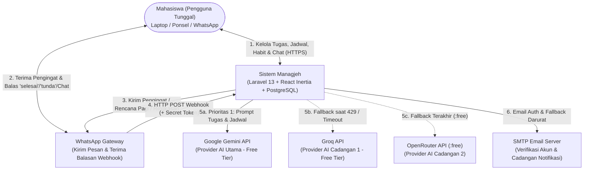
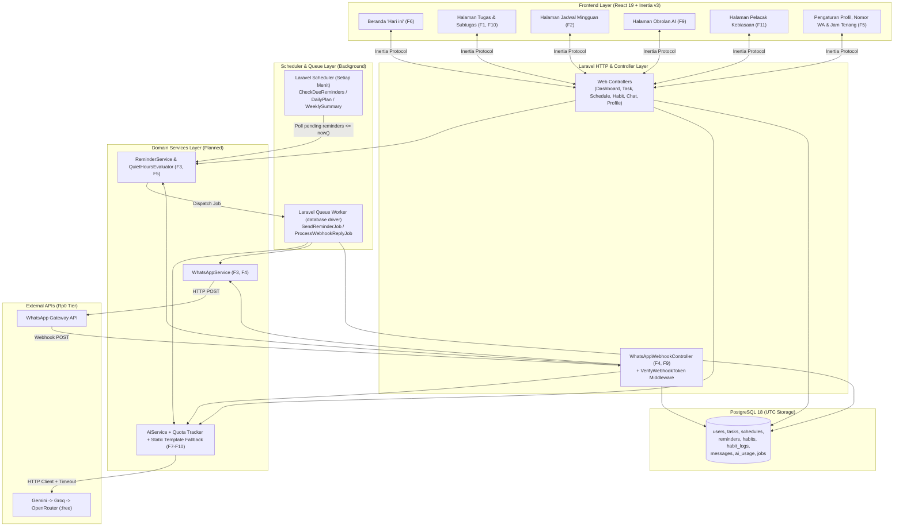
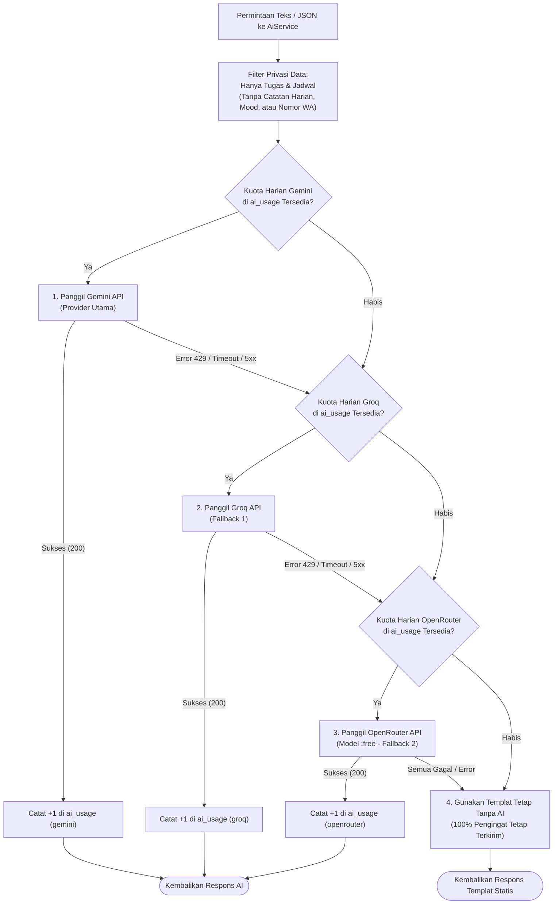

# System Architecture — Managjeh (Asisten AI Mahasiswa)

Dokumen ini mendokumentasikan arsitektur sistem **Managjeh (Asisten AI Mahasiswa)** dengan memisahkan secara tegas antara **Arsitektur Aktual yang Sudah Diimplementasikan (`FACT`)** dan **Arsitektur Target sesuai Blueprint & PRD (`REQUIREMENT` / `PLANNED`)**.

---

## 1. System Overview

- **Arsitektur Aktual (`FACT`):**
    - Aplikasi web **monorepo full-stack** berbasis **Laravel `13.42.0`** (PHP `^8.3` / `8.5.12`) di sisi backend dan **React `19.2.0` + TypeScript `^5.7.2` + Tailwind CSS v4** di sisi frontend, dihubungkan oleh **Inertia.js v3 (`3.7.0`)** dan **Laravel Wayfinder (`0.1.23`)**.
    - Menggunakan **PostgreSQL (`18.6`)** sebagai penyimpanan utama untuk data akun (`users`, `passkeys`, `password_reset_tokens`), sesi (`sessions`), cache (`cache`, `cache_locks`), dan antrean job (`jobs`, `job_batches`, `failed_jobs`).
- **Arsitektur Target (`REQUIREMENT`):**
    - Sistem **Asisten Pribadi AI Single-User** untuk mahasiswa yang menggabungkan web dashboard Inertia (`"Hari ini"`, tugas, jadwal, kebiasaan, obrolan) dengan mesin pengingat otomatis berbasis **Laravel Scheduler + Queue**, integrasi dua arah **WhatsApp Gateway & Webhook**, serta layanan **`AiService` multi-provider berbiaya Rp0** (Gemini utama -> Groq fallback 1 -> OpenRouter `:free` fallback 2 -> templat statis tanpa AI).

---

## 2. Arsitektur Aktual (`FACT` — Implemented)

### 2.1 Diagram Arsitektur Aktual

```mermaid
flowchart LR
    Browser["Browser Pengguna\n(React 19 + Inertia v3 + Tailwind v4)"]
    Vite["Vite+ (vp 1.4.0)\n@inertiajs/vite + Wayfinder"]
    HttpKernel["Laravel 13 HTTP Kernel\n(public/index.php)"]
    Middleware["Web Middleware Stack\n(Session, CSRF, HandleAppearance, HandleInertiaRequests)"]
    Router["Routes Aktual\n(web.php, settings.php, Fortify, Passkeys)"]
    Controllers["Controllers & Actions\n(ProfileController, SecurityController,\nCreateNewUser, ResetUserPassword)"]
    Auth["Laravel Auth + Fortify 1.42\n(Session Guard, TOTP 2FA, WebAuthn Passkeys)"]
    Mail["Symfony Mailer\n(SMTP / Log)"]
    DB[("PostgreSQL 18\nmanagjeh / managjeh_test")]

    Browser <-->|"Inertia XHR / HTML + Session Cookie + XSRF-TOKEN"| HttpKernel
    Vite -.->|"Bundle Aset & Wayfinder TS Routes"| Browser
    HttpKernel --> Middleware --> Router --> Controllers
    Controllers --> Auth
    Controllers --> DB
    Auth --> DB
    Auth -->|"Verifikasi Email & Reset Password"| Mail
```

### 2.2 Komponen Aktual yang Sudah Berjalan (`FACT`)

1. **Laravel + React + Inertia Monorepo (`Implemented`):**
    - Tidak memisahkan repository frontend dan backend, sehingga tidak membutuhkan REST API terpisah untuk UI web.
    - Entrypoint frontend berada di `resources/views/app.blade.php` dan `resources/js/app.tsx`.
    - `HandleInertiaRequests` membagikan props global (`name`, `auth.user`, `sidebarOpen`).
    - **Laravel Wayfinder** menghasilkan helper route/controller TypeScript di `resources/js/actions/` dan `resources/js/routes/`.
2. **PostgreSQL Persistence (`Implemented`):**
    - Koneksi default `DB_CONNECTION=pgsql` (`config/database.php`) ke database `managjeh` dan database pengujian `managjeh_test` (`phpunit.xml`).
    - Menyimpan 10 tabel infrastruktur dan autentikasi (`users`, `passkeys`, `password_reset_tokens`, `sessions`, `cache`, `cache_locks`, `jobs`, `job_batches`, `failed_jobs`, `migrations`).
3. **Authentication & Security Layer (`Implemented`):**
    - Guard `web` berbasis session database (`config/auth.php`).
    - Fitur Fortify aktif (`config/fortify.php`): registrasi, reset password, verifikasi email (`MustVerifyEmail`), 2FA TOTP (`confirm => true`, `confirmPassword => true`), dan Passkeys/WebAuthn.
4. **Timezone & Date Architecture (`Implemented`):**
    - `config/app.php` menetapkan `'timezone' => 'UTC'`.
    - `AppServiceProvider` mengonfigurasi `Date::use(CarbonImmutable::class)` dan `DB::prohibitDestructiveCommands(app()->isProduction())`.

---

## 3. Arsitektur Target (`REQUIREMENT` / `PLANNED`)

Bagian ini menjelaskan arsitektur yang direncanakan dalam Blueprint dan PRD namun **belum diimplementasikan di kode aplikasi (`Not Implemented` / `Planned`)**.

### 3.1 System Context Diagram (Target)

### 3.2 Container & Component Diagram (Target)

---

## 4. Detail Arsitektur Sub-Sistem Target (`REQUIREMENT`)

### 4.1 Single-User Architecture (`REQUIREMENT`)

- Aplikasi dirancang khusus untuk **satu pengguna tunggal** (pemilik produk).
- Tidak memerlukan tabel organisasi, tim, atau RBAC multi-role kompleks.
- Identitas pengguna WhatsApp dicocokkan langsung terhadap kolom `users.nomor_wa` milik akun pengguna tunggal tersebut.
- Pesan masuk pada webhook dari nomor telepon selain `users.nomor_wa` wajib langsung ditolak (`403 Forbidden` / diabaikan tanpa memproses AI atau mengubah data).

### 4.2 PostgreSQL & Timezone Architecture (`FACT` + `REQUIREMENT`)

- **Penyimpanan Waktu (`REQUIREMENT`):** Semua kolom waktu (`kirim_pada`, `dikirim_pada`, `tenggat`, `dibuat_pada`, `created_at`, `updated_at`) disimpan dalam **UTC** (`config('app.timezone') === 'UTC'` sudah aktif sebagai `FACT`).
- **Tampilan & Evaluasi Harian (`REQUIREMENT`):** Ditampilkan kepada pengguna dan dievaluasi terhadap jam tenang maupun batas pergantian hari menggunakan zona waktu **`Asia/Jakarta`** (atau nilai `users.zona_waktu`).

### 4.3 Scheduler Architecture (`REQUIREMENT` — `Not Implemented`)

- Didefinisikan di `routes/console.php` menggunakan facade `Illuminate\Support\Facades\Schedule`:
    1. **Pemeriksa Pengingat (Tiap Menit — `everyMinute()`):**
        - Mencari baris di tabel `reminders` dengan `status = 'pending'` dan `kirim_pada <= now()` (UTC).
        - Mengevaluasi apakah waktu saat ini berada dalam rentang jam tenang (`jam_tenang_mulai` s.d. `jam_tenang_selesai` dalam `Asia/Jakarta`).
        - Jika berada di jam tenang, nilai `kirim_pada` digeser ke akhir jam tenang (`jam_tenang_selesai`) dan tidak dikirim saat itu.
        - Jika di luar jam tenang, status diubah ke `processing` (untuk mencegah pengambilan ganda pada menit berikutnya) dan job pengiriman didorong ke Laravel Queue.
    2. **Perencana Harian Pagi (Tahap 2 — `dailyAt(...)`):**
        - Berjalan setiap pagi setelah jam tenang selesai untuk menyusun rencana harian via `AiService` dan menjadwalkan pengirimannya ke WhatsApp (`F7`).
    3. **Ringkasan Mingguan (Tahap 3 — `weeklyOn(0, ...)`):**
        - Berjalan setiap Minggu malam untuk merangkum penyelesaian tugas dan streak kebiasaan (`F11`).

### 4.4 Queue & Notification Delivery Flow (`PARTIALLY IMPLEMENTED`)

- **Kondisi Aktual (`FACT`):** Driver queue `database` (`QUEUE_CONNECTION=database`) dan tabel `jobs`, `job_batches`, `failed_jobs` sudah tersedia di PostgreSQL.
- **Alur Target (`REQUIREMENT`):**
    1. Job pengiriman mengambil detail pengingat beserta konteks `tasks` atau `schedules`.
    2. Menyusun teks pesan:
        - Menggunakan **templat tetap** untuk pengingat rutin/sederhana.
        - Menggunakan **`AiService`** untuk pengingat kontekstual, rencana pagi (`F7`), atau balasan obrolan (`F9`).
    3. Mengirim pesan melalui `WhatsAppService` ke gateway WhatsApp.
    4. Jika berhasil: menandai `reminders.status = 'sent'` (atau `'terkirim'`) dan mengisi `dikirim_pada = now()`.
    5. Jika gagal sementara (timeout/5xx dari gateway): Job melakukan _retry_ dengan _backoff_ beberapa kali.
    6. Jika seluruh percobaan gagal: menandai `reminders.status = 'failed'` (atau `'gagal'`) agar muncul sebagai peringatan di beranda `"Hari ini"`.

### 4.5 WhatsApp Gateway & Webhook Architecture (`REQUIREMENT` — `Not Implemented`)

- **Outbound (Kirim Pesan):**
    - `WhatsAppService` membungkus HTTP client Laravel (`Http::timeout(...)->withToken(...)`) menuju endpoint gateway WhatsApp yang dikonfigurasi di `.env` / `config/services.php`.
- **Inbound (Terima Balasan via Webhook):**
    - Gateway memanggil endpoint webhook Laravel ketika pengguna membalas pesan di WhatsApp.
    - **Lapisan Keamanan Webhook:**
        1. Memverifikasi token rahasia (`WHATSAPP_WEBHOOK_SECRET`) dari header atau payload.
        2. Menormalisasi dan mencocokkan nomor pengirim dengan `users.nomor_wa`.
    - **Routing Perintah Balasan:**
        - `"selesai"` -> menandai tugas terkait sebagai selesai (`done`), memperbarui pengingat terkait, lalu mengirim balasan konfirmasi singkat.
        - `"tunda"` -> menggeser waktu `kirim_pada` pengingat sebesar **+30 menit** (dengan tetap memperhatikan jam tenang), mengubah status kembali ke `pending`, lalu mengirim balasan konfirmasi singkat.
        - **Teks bebas lainnya** -> disimpan ke tabel `messages` (`arah = 'incoming'`), diteruskan ke `AiService` dengan konteks tugas/jadwal, dan balasannya dikirim kembali ke WhatsApp serta dicatat di `messages` (`arah = 'outgoing'`).

### 4.6 AI Service & Provider Fallback Architecture (`REQUIREMENT` — `Not Implemented`)

- **Aturan Arsitektur `AiService` (`REQUIREMENT`):**
    1. Satu pintu masuk (`App\Services\AiService`) untuk seluruh fitur AI (`F7` Perencana Harian, `F8` Pengingat Kontekstual, `F9` Obrolan, `F10` Pemecah Tugas).
    2. **Urutan Pemanggilan Ketat:** Gemini -> Groq -> OpenRouter (`:free`) -> Templat Tetap tanpa AI.
    3. **Proteksi Kuota (`ai_usage`):** Sebelum memanggil provider, periksa jumlah permintaan pada tanggal berjalan di tabel `ai_usage`. Jika sudah menyentuh batas aman harian, langsung lompat ke provider berikutnya.
    4. **Keluaran Terstruktur (JSON):** Untuk fitur Perencana Harian (`F7`) dan Pemecah Tugas (`F10`), meminta format output JSON terstruktur dan melakukan validasi skema JSON sebelum disimpan ke database.
    5. **Sanitasi Privasi:** Konteks yang dikirim ke provider AI hanya boleh berisi daftar tugas dan jadwal; dilarang menyertakan catatan harian sensitif, mood, atau nomor WhatsApp.

---

## 5. Perbandingan Ringkas Arsitektur Aktual vs Target

| Komponen Arsitektur      | Kondisi Aktual (`FACT`)                                                             | Target Blueprint & PRD (`REQUIREMENT`)                                                 | Status                                |
| ------------------------ | ----------------------------------------------------------------------------------- | -------------------------------------------------------------------------------------- | ------------------------------------- |
| **Web App & SPA Layer**  | Laravel 13 + Inertia v3 + React 19 + Wayfinder                                      | Laravel + Inertia + React untuk beranda, tugas, jadwal, habit, obrolan                 | `Implemented` (fondasi)               |
| **Database Engine**      | PostgreSQL 18 (`managjeh` & `managjeh_test`)                                        | PostgreSQL (menyimpan semua waktu dalam UTC)                                           | `Implemented` (koneksi & tabel dasar) |
| **Auth & Security**      | Fortify (Session, Email Verify, 2FA, Passkeys)                                      | Single-user auth + proteksi token webhook & nomor WA                                   | `Partially Implemented`               |
| **Scheduler**            | Belum ada jadwal di `routes/console.php`                                            | Jalan tiap menit untuk `reminders`, pagi untuk rencana, Minggu malam untuk ringkasan   | `Not Implemented`                     |
| **Queue System**         | Tabel `jobs` & `failed_jobs` ada (`QUEUE_CONNECTION=database`), belum ada Job class | Memproses pengiriman WA & balasan secara asinkron dengan retry                         | `Partially Implemented`               |
| **WhatsApp Integration** | Tidak ada                                                                           | Outbound gateway + Inbound webhook (`"selesai"`, `"tunda"`, teks bebas)                | `Not Implemented`                     |
| **AI Service Layer**     | Tidak ada                                                                           | `AiService` (Gemini -> Groq -> OpenRouter `:free` -> Templat tetap) + tabel `ai_usage` | `Not Implemented`                     |

---

## 6. TODO

- [ ] Memilih provider WhatsApp Gateway spesifik (`UNKNOWN`) dan mendokumentasikan spesifikasi arsitektur transport-nya.
- [ ] Menentukan topologi hosting produksi gratis yang mampu menjalankan proses `schedule:run` (tiap menit) dan `queue:work`.
- [ ] Memperbarui diagram arsitektur aktual seiring diimplementasikannya modul Minggu 1 s.d. Minggu 6.
