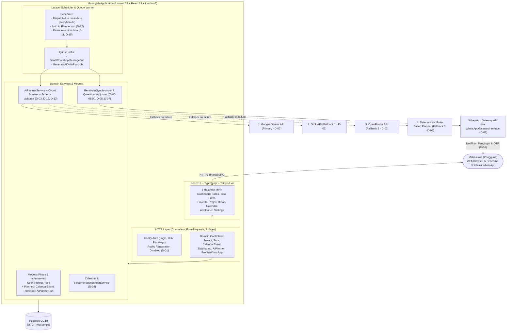

# System Architecture — Managjeh (Personal OS Mahasiswa — MVP 1)

Dokumen ini mendokumentasikan arsitektur sistem **Managjeh MVP 1**, memisahkan antara komponen yang **sudah berjalan (`FACT` — Phase 0 & Phase 1)** dan komponen yang **direncanakan (`REQUIREMENT` — Phase 2 s.d. Phase 7)**.

---

## 1. Gambaran Umum Arsitektur

- **Monorepo Full-Stack:** Laravel `13.42.0` (PHP `8.5.12`) + Inertia.js v3 (`3.7.0`) + React `19.2.0` + TypeScript + Tailwind CSS v4 + Laravel Wayfinder `0.1.23`.
- **Database:** PostgreSQL (`managjeh` & `managjeh_test`). Semua timestamp absolut disimpan dalam **UTC**, sedangkan tampilan dan evaluasi jadwal mengikuti `users.timezone` (IANA timezone, default `Asia/Jakarta`).
- **Model Kepemilikan:** *Single-user sekarang, arsitektur siap multi-user*. Seluruh tabel bisnis memiliki `user_id` dan dilindungi Policy. Registrasi publik dinonaktifkan (`D-01`).

---

## 2. Diagram Konteks & Komponen Sistem (MVP 1)

---

## 3. Pemisahan Tanggung Jawab Backend

1. **Controller (`app/Http/Controllers/`):** Menerima request, memanggil FormRequest & Policy (`$this->authorize(...)`), memanggil Service/Model, dan mengembalikan response Inertia atau redirect dengan flash toast.
2. **Form Request (`app/Http/Requests/`):** Menangani validasi input, pemeriksaan kepemilikan relasi (`project_id`, `parent_id`, `task_id`), dan normalisasi timezone input ke UTC.
3. **Policy (`app/Policies/`):** Memastikan pengguna hanya dapat mengakses dan memodifikasi resource dengan `user_id === $user->id`.
4. **Service (`app/Services/`):** Menangani logika lintas-model seperti ekspansi agenda berulang (`D-08`), sinkronisasi pengingat & jam tenang (`00:00–05:00` `D-06`), agregasi dashboard, serta orkestrasi fallback AI Planner (`D-03`).
5. **Job (`app/Jobs/`):** Menjalankan pengiriman WhatsApp dan pemanggilan AI secara asynchronous dengan idempotency, retry terbatas, dan backoff.
6. **Contract / Provider (`app/Contracts/`):** Mengisolasi vendor WhatsApp (`WhatsAppGatewayInterface`) dan provider AI (`AiPlannerProviderInterface`).
