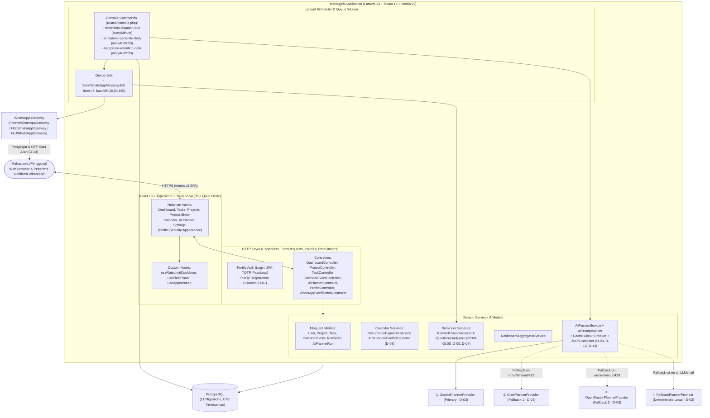

# System Architecture — Managjeh (Personal OS Mahasiswa — MVP 1)

Dokumen ini mendokumentasikan arsitektur sistem **Managjeh MVP 1** yang telah diimplementasikan dan terverifikasi penuh (`Implemented & Verified` — Phase 0 s.d. Phase 7).

---

## 1. Gambaran Umum Arsitektur (`FACT`)

- **Monolith Full-Stack Modern:** Laravel `13.42.0` (PHP `8.5.12`) + Inertia.js v3 (`3.7.0`) + React `19.2.0` + TypeScript + Tailwind CSS v4 + Laravel Wayfinder `0.1.23`.
- **Database & Penyimpanan:** PostgreSQL (`managjeh` untuk runtime aplikasi, `managjeh_test` untuk pengujian otomatis). Seluruh timestamp absolut disimpan dalam **UTC** (`CarbonImmutable`), sementara tampilan dan evaluasi jadwal harian mengikuti `users.timezone` (IANA timezone, default `Asia/Jakarta`).
- **Model Kepemilikan:** _Single-user sekarang, arsitektur siap multi-user_. Seluruh tabel domain memiliki `user_id` dan dilindungi Policy. Registrasi publik dinonaktifkan (`D-01`).

---

## 2. Diagram Konteks & Komponen Sistem

---

## 3. Pemisahan Tanggung Jawab Backend (`app/`)

1. **Controllers (`app/Http/Controllers/`):** Menerima request, menjalankan FormRequest & Policy (`Gate::authorize(...)`), memanggil Service atau Model, dan mengembalikan response Inertia, redirect dengan flash toast, atau unduhan JSON (`ProfileController@export`).
2. **Form Requests (`app/Http/Requests/`):** Menangani validasi input, pemeriksaan kepemilikan relasi (`project_id`, `parent_id`, `task_id`), dan konversi waktu input lokal (`users.timezone`) ke UTC (`normalizedValidated()`).
3. **Policies (`app/Policies/`):** `ProjectPolicy`, `TaskPolicy`, dan `CalendarEventPolicy` memastikan pengguna hanya dapat mengakses resource dengan `user_id === $user->id`.
4. **Services (`app/Services/`):**
    - `Calendar\RecurrenceExpanderService` & `Calendar\ScheduleConflictDetector`: Mengekspansi kejadian berulang (`DAILY`/`WEEKLY`/`MONTHLY`), menerapkan `recurrence_exceptions` serta _single-occurrence overrides_, dan mendeteksi konflik waktu.
    - `Reminder\QuietHoursAdjuster` & `Reminder\ReminderSynchronizer`: Menyesuaikan waktu pengingat di luar jam tenang (`00:00–05:00` lokal) dan menyinkronkan reminder otomatis saat tugas/agenda berubah.
    - `DashboardAggregatorService`: Mengagregasi 8 bagian utama Dashboard secara efisien.
    - `AiPlanner\AiPlannerService` & `AiPromptBuilder`: Membentuk konteks tersanitasi (`AiPlannerContext`), mengelola _circuit breaker_ cache per provider, menjalankan rantai fallback, memvalidasi output JSON terhadap ID tugas aktif, dan membuat reminder yang disetujui pengguna (`approveReminder()`).
5. **Contracts & Adapters (`app/Contracts/`, `app/Services/WhatsApp/`, `app/Services/AiPlanner/`):**
    - `WhatsAppGatewayInterface` → `FonnteWhatsAppGateway`, `HttpWhatsAppGateway`, `NullWhatsAppGateway`.
    - `AiPlannerProviderInterface` → `GeminiPlannerProvider`, `GrokPlannerProvider`, `OpenRouterPlannerProvider`, `FallbackPlannerProvider`.
6. **Jobs & Console Commands (`app/Jobs/`, `app/Console/Commands/`):**
    - `SendWhatsAppMessageJob`: Mengirim pesan WhatsApp secara asynchronous dengan pemeriksaan ulang persetujuan user, keaktifan sumber, dan `idempotency_key`.
    - `ProvisionUserCommand` (`user:provision`), `DispatchDueRemindersCommand` (`reminders:dispatch-due`), `GenerateDailyAiPlansCommand` (`ai-planner:generate-daily`), dan `PruneRetentionDataCommand` (`app:prune-retention-data`).
