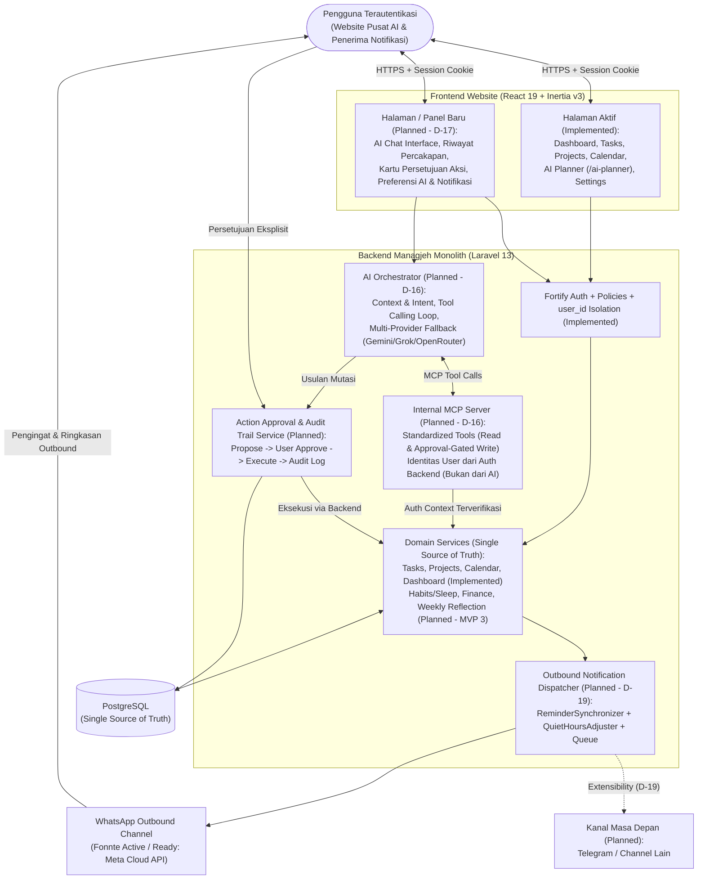

# System Architecture — Managjeh (Personal OS Mahasiswa — MVP 1)

Dokumen ini mendokumentasikan arsitektur sistem **Managjeh MVP 1** yang telah diimplementasikan dan terverifikasi penuh (`Implemented & Verified` — Phase 0 s.d. Phase 7).

---

## 1. Gambaran Umum Arsitektur (`FACT`)

- **Monolith Full-Stack Modern:** Laravel `13.42.0` (PHP `8.5.12`) + Inertia.js v3 (`3.7.0`) + React `19.2.0` + TypeScript + Tailwind CSS v4 + Laravel Wayfinder `0.1.23`.
- **Database & Penyimpanan:** PostgreSQL (`managjeh` untuk runtime aplikasi, `managjeh_test` untuk pengujian otomatis). Seluruh timestamp absolut disimpan dalam **UTC** (`CarbonImmutable`), sementara tampilan dan evaluasi jadwal harian mengikuti `users.timezone` (IANA timezone, default `Asia/Jakarta`).
- **Model Kepemilikan:** _Single-user sekarang, arsitektur siap multi-user_. Seluruh tabel domain memiliki `user_id` dan dilindungi Policy. Registrasi publik dinonaktifkan (`D-01`).

---

## 2. Diagram Konteks & Komponen Sistem

---

## 3. Pemisahan Tanggung Jawab Backend (`app/`)

1. **Controllers (`app/Http/Controllers/`):** Menerima request, menjalankan FormRequest & Policy (`Gate::authorize(...)`), memanggil Service atau Model, dan mengembalikan response Inertia, redirect dengan flash toast, atau unduhan JSON (`ProfileController@export`).
2. **Form Requests (`app/Http/Requests/`):** Menangani validasi input, pemeriksaan kepemilikan relasi (`project_id`, `parent_id`, `task_id`), dan konversi waktu input lokal (`users.timezone`) ke UTC (`normalizedValidated()`).
3. **Policies (`app/Policies/`):** `ProjectPolicy`, `TaskPolicy`, dan `CalendarEventPolicy` memastikan pengguna hanya dapat mengakses resource dengan `user_id === $user->id`.
4. **Services (`app/Services/`):**
    - `Calendar\RecurrenceExpanderService` & `Calendar\ScheduleConflictDetector`: Mengekspansi kejadian berulang (`DAILY`/`WEEKLY`/`MONTHLY`), menerapkan `recurrence_exceptions` serta _single-occurrence overrides_, dan mendeteksi konflik waktu.
    - `Reminder\QuietHoursAdjuster` & `Reminder\ReminderSynchronizer`: Menyesuaikan waktu pengingat di luar jam tenang (`00:00–05:00` lokal) dan menyinkronkan reminder otomatis saat tugas/agenda berubah.
    - `DashboardAggregatorService`: Mengagregasi 8 bagian utama Dashboard secara efisien.
    - `AiPlanner\AiPlannerService` & `AiPromptBuilder`: Membentuk konteks tersanitasi (`AiPlannerContext`), mengelola _circuit breaker_ cache per provider, menjalankan rantai fallback, memvalidasi output JSON terhadap ID tugas aktif, dan membuat reminder yang disetujui pengguna (`approveReminder()`).
5. **Contracts & Adapters (`app/Contracts/`, `app/Services/WhatsApp/`, `app/Services/AiPlanner/`):**
    - `WhatsAppGatewayInterface` → `FonnteWhatsAppGateway`, `HttpWhatsAppGateway`, `NullWhatsAppGateway`.
    - `AiPlannerProviderInterface` → `GeminiPlannerProvider`, `GrokPlannerProvider`, `OpenRouterPlannerProvider`, `FallbackPlannerProvider`.
6. **Jobs & Console Commands (`app/Jobs/`, `app/Console/Commands/`):**
    - `SendWhatsAppMessageJob`: Mengirim pesan WhatsApp secara asynchronous dengan pemeriksaan ulang persetujuan user, keaktifan sumber, dan `idempotency_key`.
    - `ProvisionUserCommand` (`user:provision`), `DispatchDueRemindersCommand` (`reminders:dispatch-due`), `GenerateDailyAiPlansCommand` (`ai-planner:generate-daily`), dan `PruneRetentionDataCommand` (`app:prune-retention-data`).

---

## 4. Arsitektur Target Lanjutan — Website AI Hub, Internal MCP & Multi-Channel Outbound (`CONFIRMED` / `Planned` — `D-16` s.d. `D-19`)

Bagian ini mendokumentasikan arah arsitektur **MVP 2 & MVP 3** yang sudah dikonfirmasi oleh pemilik produk dan **belum diimplementasikan** di kode saat ini. Seluruh komponen baru dirancang di dalam **monolith Laravel** yang sama (`D-16`) agar business logic, autentikasi sesi, dan otorisasi tetap tunggal (_single source of truth_).

### 4.1 Dampak & Keputusan Arsitektur Terkunci MVP 2 (`CONFIRMED` / `Planned` — Belum Diimplementasikan)

- **Backend (Laravel 13 Monolith):**
    - **Internal MCP Server (`app/Mcp/` — Tanpa Dependensi Baru):** `McpToolInterface`, `McpToolRegistry`, dan `McpToolExecutor` dengan definisi kontrak JSON Schema kompatibel MCP yang dieksekusi **in-process** memakai objek `User` dari sesi Laravel (tanpa endpoint HTTP `/mcp` eksternal di MVP 2). Mengekspos 6 Read Tools (`get_my_tasks`, `get_upcoming_tasks`, `get_today_schedule`, `get_schedule_range` termasuk slot kosong, `get_my_projects`, `get_daily_overview`) dan 4 Write Tools non-destruktif (`create_task`, `update_task`, `create_schedule`, `update_schedule`).
    - **AI Orchestrator (`app/Services/AiChat/`):** Menggunakan _native function/tool calling_ masing-masing provider (`Gemini` `functionDeclarations` → `Grok` & `OpenRouter` OpenAI-compatible `tools`) dengan batas **maksimal 4 putaran tool-call** per pesan dan _sliding window_ **16 pesan terakhir**. Pemanggilan write tool selalu dicegat menjadi baris `ai_action_proposals` (tidak dieksekusi di dalam loop LLM); jika seluruh provider gagal, sistem mengembalikan pesan error ramah tanpa chat fallback tiruan.
    - **Action Approval & Audit Trail Service:** Mengelola proposal pending ber-TTL **24 jam**, pratinjau bentrok jadwal otomatis via `ScheduleConflictDetector`, persetujuan selektif per item, re-validasi kepemilikan & Policy secara idempoten saat eksekusi, serta pencatatan hasil audit.
    - **Ekstensi Notifikasi & Multi-Channel Outbound:** Memperkenalkan `OutboundChannelInterface` + `OutboundChannelManager` (routing berdasarkan `reminders.channel`, kanal `whatsapp` mendelegasikan ke `WhatsAppGatewayInterface`) + driver adapter `MetaCloudWhatsAppGateway` (`meta_cloud`), sementara integrasi Telegram aktif ditunda sampai dibutuhkan. Menambahkan generator ringkasan harian (`07:00` lokal) & mingguan (`Minggu 19:00` lokal) secara **deterministik (rule-based)**, `event_prep` (H-15 menit), dan **rolling sync 48 jam** harian via `RecurrenceExpanderService` untuk agenda berulang.
    - **Hardening, Retensi & Ekspor:** Menambahkan rate limiter `ai-chat` (`20 req/menit`), middleware **HTTP Security Headers** (`HSTS`, `X-Frame-Options`, `X-Content-Type-Options`, `Referrer-Policy`, `COOP`, baseline `CSP`), perluasan `PruneRetentionDataCommand` untuk memangkas `ai_chat_conversations`, `ai_chat_messages`, dan `ai_action_proposals` > 30 hari (`D-19`), serta memasukkan `ai_action_proposals` ter-whitelist ke `ProfileController@export`.
- **Frontend (React 19 + Inertia v3):**
    - Halaman khusus **`/ai-chat`** di sidebar utama ("AI Chat") berdampingan dengan `/ai-planner` (`D-17`) dengan layout 2 kolom desktop + drawer riwayat mobile (`375px`) + starter prompt chips.
    - Pengiriman pesan memakai **synchronous JSON request-response** (`fetch` / Inertia `useHttp`) dengan optimistic user bubble, indikator memproses, dan `useRateLimitCooldown` untuk HTTP `429`.
    - Kartu Rencana Aksi (checkbox per item, badge bentrok jadwal, tombol **Setujui Terpilih** / **Tolak Semua**), panel/tab ringkas **"Riwayat Aksi AI"**, serta tab Settings baru **`/settings/ai`** untuk preferensi AI & pengaturan notifikasi outbound.
- **Infrastruktur & Deployment:**
    - Karena MCP Server dan AI Orchestrator berada **in-process di dalam monolith Laravel (`D-16`)** dengan mode **synchronous JSON request-response** (bukan SSE long-lived dan tidak menunggu antrean `queue:work --sleep=15`), deployment tetap berjalan di satu container FrankenPHP Railway (`GOMAXPROCS=1`) tanpa microservice tambahan. Scheduler harian tambahan menangani rolling sync 48 jam agenda berulang dan penjadwalan digest harian/mingguan.
