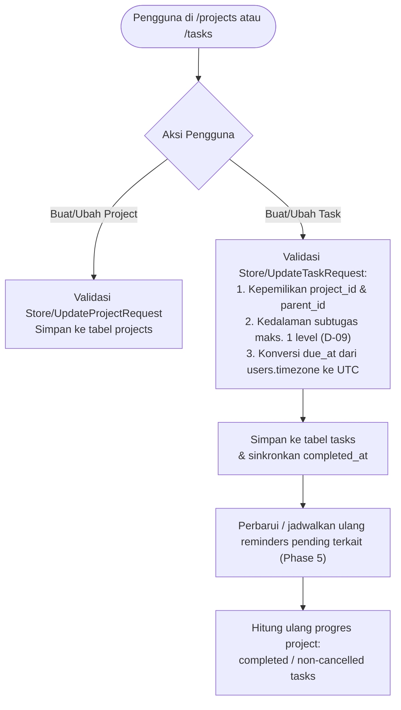
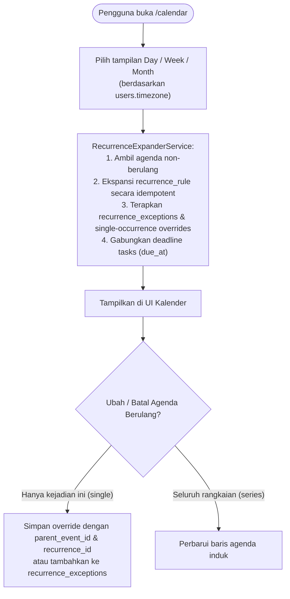
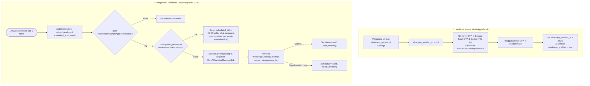
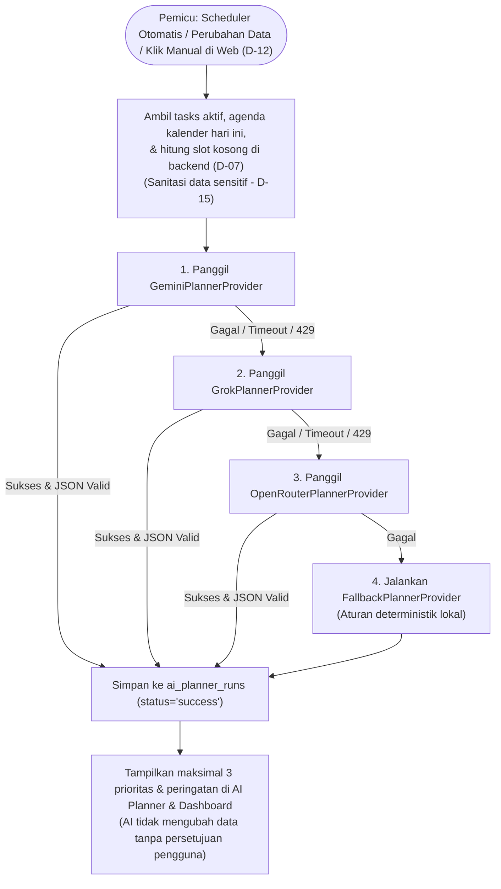

# User Flow — Managjeh (Personal OS Mahasiswa — MVP 1)

Dokumen ini mendokumentasikan alur interaksi pengguna dan sistem pada **Managjeh MVP 1** berdasarkan spesifikasi teknis dan keputusan final `D-01` s.d. `D-15`.

---

## 1. Alur Provisioning Akun & Autentikasi (`D-01` — `Implemented`)

Karena registrasi publik dinonaktifkan (`D-01`), akun dibuat melalui CLI lalu pengguna login melalui browser:

---

## 2. Alur Pengelolaan Proyek, Tugas & Subtugas (`Phase 1–2`, `D-09`, `D-11`)

---

## 3. Alur Kalender & Agenda Berulang (`Phase 3`, `D-08`)

---

## 4. Alur Verifikasi Nomor WhatsApp & Pengiriman Reminder (`Phase 5`, `D-02`, `D-05`, `D-06`, `D-14`)

---

## 5. Alur AI Planner (`Phase 6`, `D-03`, `D-04`, `D-07`, `D-12`, `D-13`)

