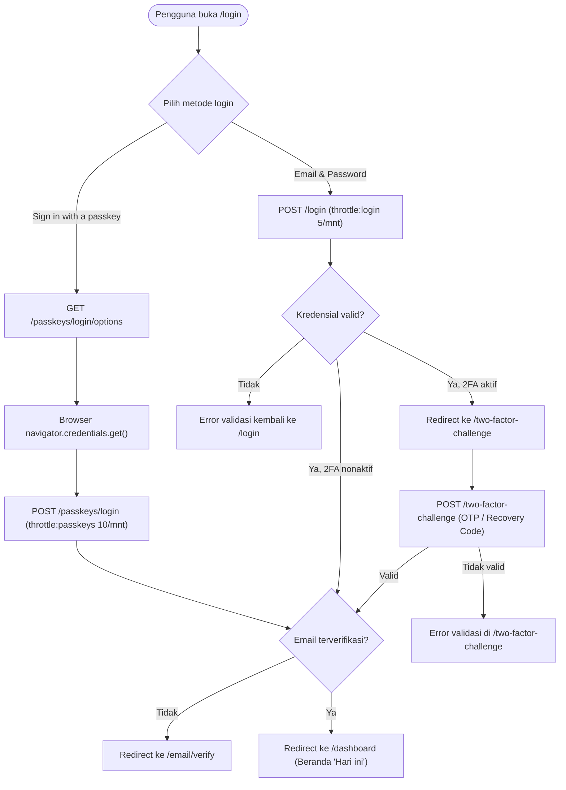
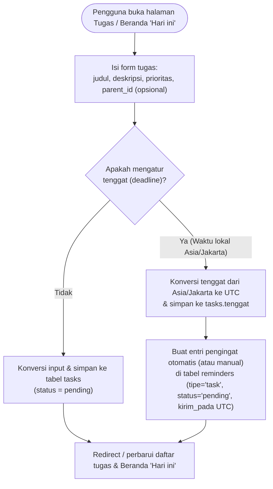
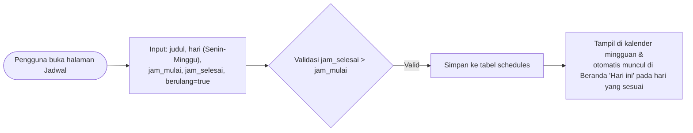
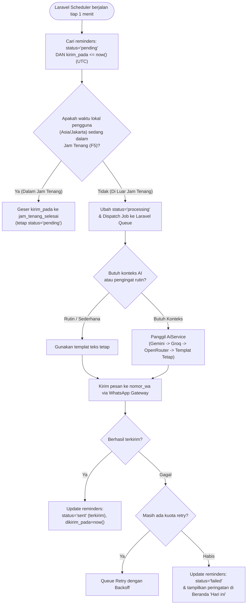
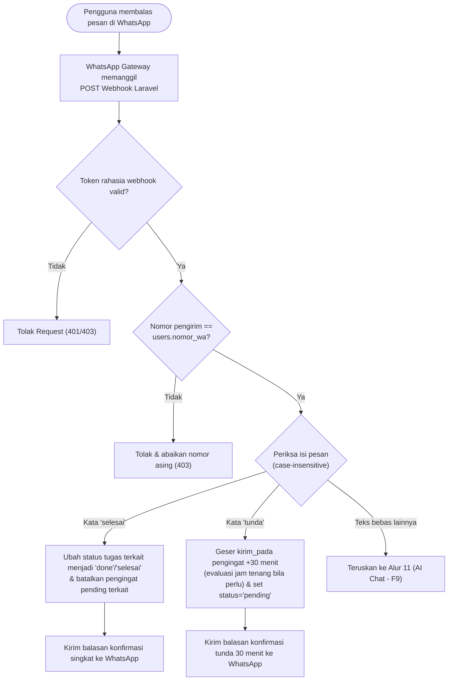
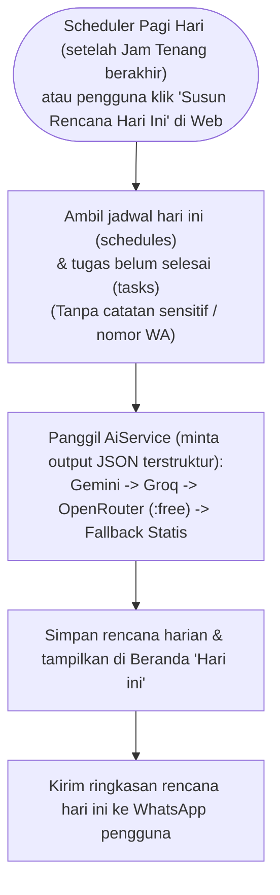
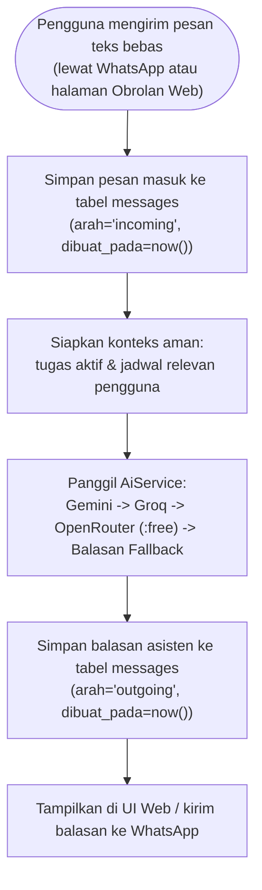
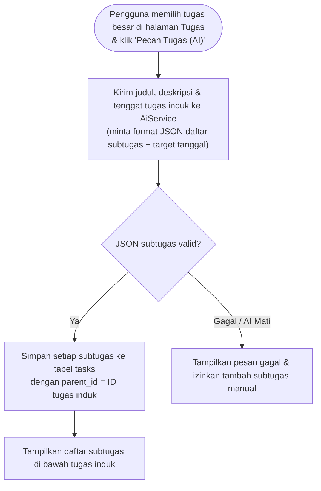

# User Flow — Managjeh (Asisten AI Mahasiswa)

Dokumen ini mendokumentasikan alur interaksi pengguna dan sistem pada **Managjeh**, dengan membedakan antara **Alur Aktual yang Sudah Diimplementasikan (`FACT`)** dan **Alur Target Asisten AI Mahasiswa (`REQUIREMENT` / `PLANNED`)**.

---

## 1. Daftar Aktor

- **Mahasiswa / Pengguna Tunggal (`REQUIREMENT` & `FACT`):** Pemilik produk yang berinteraksi melalui web browser (React + Inertia) dan aplikasi **WhatsApp** di ponsel/laptop.
- **Laravel Scheduler & Queue Worker (`REQUIREMENT`):** Aktor sistem latar belakang yang memicu pengingat, rencana harian pagi, dan ringkasan mingguan.
- **WhatsApp Gateway (`REQUIREMENT`):** Layanan perantara pengiriman pesan keluar dan penerusan balasan pengguna ke webhook Laravel.
- **AI Providers (`REQUIREMENT`):** Gemini (utama), Groq (fallback 1), dan OpenRouter `:free` (fallback 2).

---

## 2. Alur 1: Login, 2FA, Passkey, Verifikasi Email & Pengaturan Akun (`FACT` — Implemented)

Alur autentikasi dan pengaturan akun berikut **sudah diimplementasikan penuh** menggunakan Laravel Fortify `1.42.0` dan `@laravel/passkeys`:

- **Registrasi & Verifikasi Email (`FACT`):** `POST /register` -> `CreateNewUser` -> kirim email verifikasi -> klik signed URL `GET /email/verify/{id}/{hash}` -> redirect `/dashboard`.
- **Reset Password (`FACT`):** `POST /forgot-password` -> link email -> `POST /reset-password` (`ResetUserPassword`).
- **Pengaturan Akun (`FACT`):**
    - `/settings/profile`: ubah nama/email dan hapus akun (`ProfileController`). _(Pada Minggu 1 akan diperluas dengan input `nomor_wa`, `zona_waktu`, `jam_tenang_mulai`, `jam_tenang_selesai`)._
    - `/settings/security`: ubah password, kelola TOTP 2FA, dan kelola Passkeys (`SecurityController`, dilindungi `RequirePassword`).
    - `/settings/appearance`: ubah tema `light` / `dark` / `system`.

---

## 3. Alur 2, 3 & 5: Membuat Tugas, Mengatur Deadline & Membuat Pengingat (`REQUIREMENT` — `F1`, `F3`)

> **Status:** `Not Implemented` (`Planned` — Minggu 1 & Minggu 3).

1. **Membuat Tugas (`F1`):** Pengguna mengisi `judul`, `prioritas` (`rendah`/`sedang`/`tinggi`), dan opsional `deskripsi` atau `parent_id` (jika subtugas).
2. **Mengatur Deadline (`F1`):** Pengguna memilih tanggal dan jam tenggat dalam waktu lokal `Asia/Jakarta`; backend mengonversinya ke **UTC** sebelum menyimpan ke `tasks.tenggat`.
3. **Membuat Pengingat (`F3`):** Sistem membuat baris di tabel `reminders` secara otomatis berdasarkan `tenggat` tugas (atau pengguna menambahkan waktu pengingat kustom) dengan `status = 'pending'`.

---

## 4. Alur 4: Membuat Jadwal Mingguan Berulang (`REQUIREMENT` — `F2`)

> **Status:** `Not Implemented` (`Planned` — Minggu 1).

---

## 5. Alur 6 & 9: Pengiriman Pengingat WhatsApp & Evaluasi Jam Tenang (_Quiet Hours_) (`REQUIREMENT` — `F3`, `F5`, `F8`)

> **Status:** `Not Implemented` (`Planned` — Minggu 2 & Minggu 3).

---

## 6. Alur 7 & 8: Membalas `"selesai"` dan `"tunda"` via Webhook WhatsApp (`REQUIREMENT` — `F4`)

> **Status:** `Not Implemented` (`Planned` — Minggu 2).

---

## 7. Alur 10: AI Daily Planner / Perencana Harian (`REQUIREMENT` — `F7`, `F8`)

> **Status:** `Not Implemented` (`Planned` — Minggu 4).

---

## 8. Alur 11: AI Chat / Obrolan Asisten (`REQUIREMENT` — `F9`, `F8`)

> **Status:** `Not Implemented` (`Planned` — Minggu 5).

---

## 9. Alur 12: AI Task Breakdown / Pemecah Tugas (`REQUIREMENT` — `F10`, `F8`)

> **Status:** `Not Implemented` (`Planned` — Minggu 5).

---

## 10. Alur 13 & 14: Habit Tracking & Weekly Summary (`REQUIREMENT` — `F11`)

> **Status:** `Not Implemented` (`Planned` — Minggu 6).

```mermaid
flowchart TD
    subgraph DailyHabit["Alur 13: Pelacak Kebiasaan Harian"]
        OpenHabit(["Pengguna buka halaman Kebiasaan / Beranda"]) --> ToggleHabit["Centang kebiasaan selesai untuk tanggal hari ini (Asia/Jakarta)"]
        ToggleHabit --> UpsertLog["Simpan ke habit_logs (habit_id, tanggal, selesai=true)"]
        UpsertLog --> CalcStreak["Hitung ulang streak hari berturut-turut"]
    end

    subgraph SundaySummary["Alur 14: Ringkasan Mingguan (Minggu Malam)"]
        SundayCron(["Scheduler Minggu Malam"]) --> AggregateData["Hitung total tugas selesai 7 hari terakhir\n& streak aktif di habit_logs"]
        AggregateData --> ComposeSummary["Susun pesan ringkasan mingguan\n(via AiService atau templat tetap)"]
        ComposeSummary --> SendSummaryWA["Kirim ringkasan mingguan ke WhatsApp pengguna"]
    end
```

---

## 11. TODO

- [ ] Menentukan format pesan konfirmasi standar untuk balasan `"selesai"` dan `"tunda"`.
- [ ] Menentukan jam eksekusi default untuk pengiriman Rencana Harian Pagi (`F7`) dan Ringkasan Mingguan Minggu Malam (`F11`).
