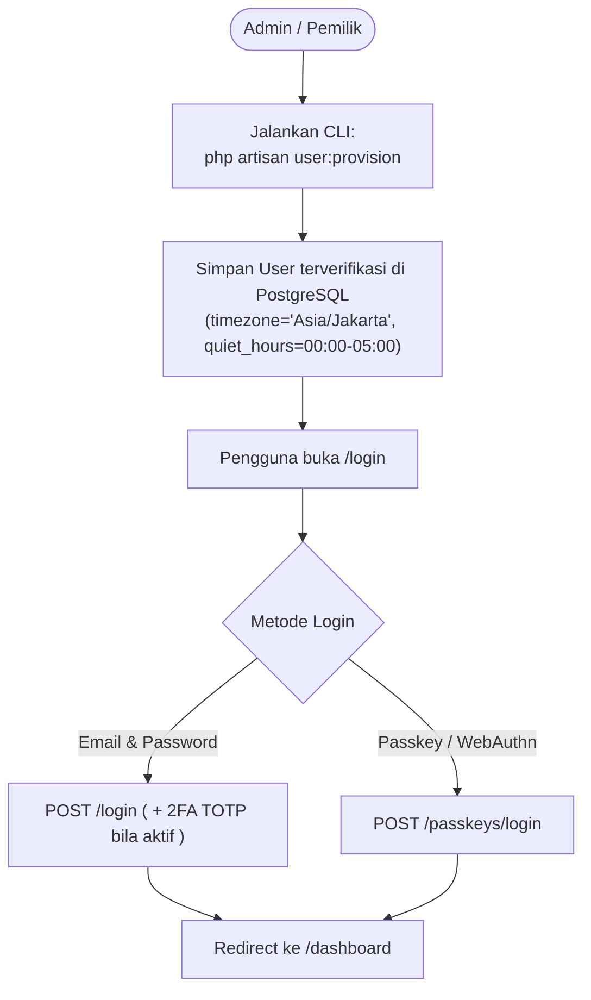
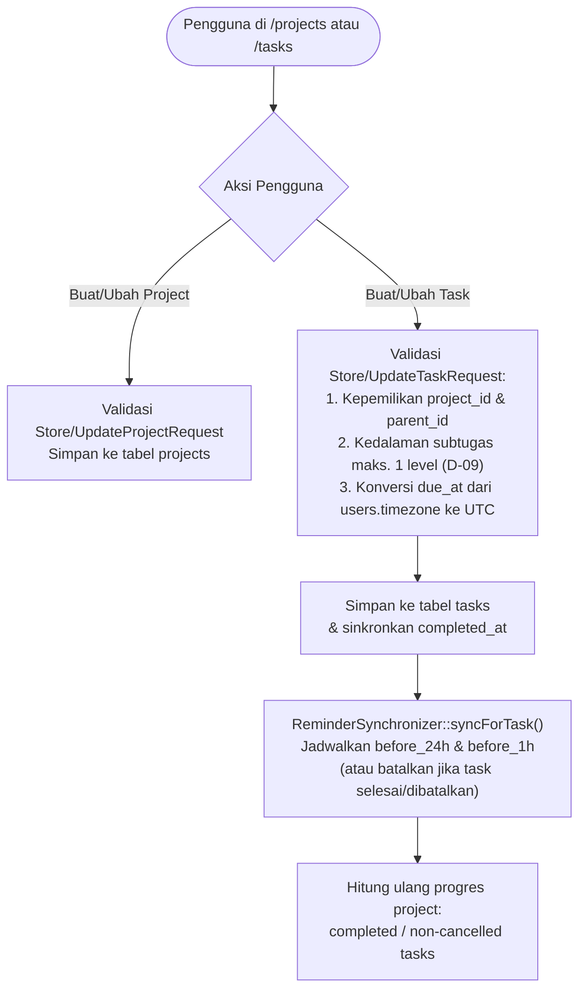
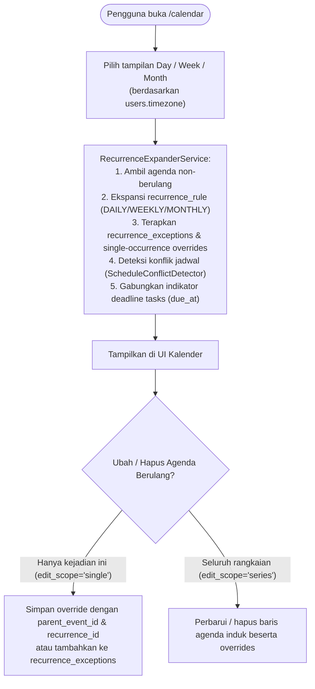
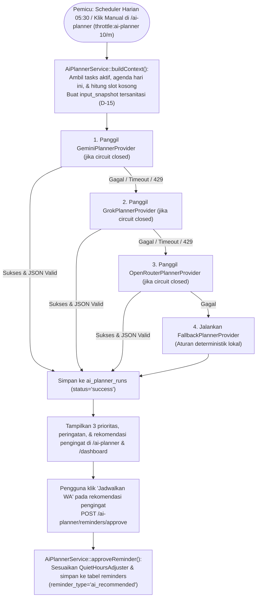
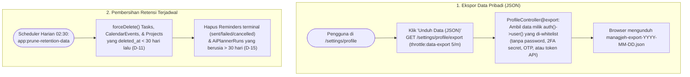
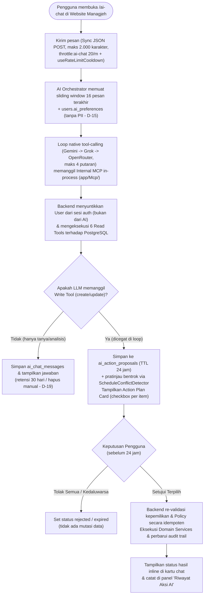
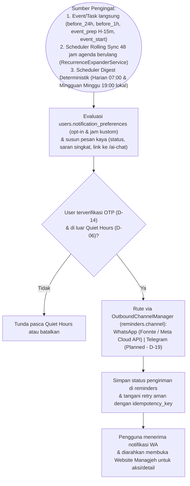

# User Flow — Managjeh (Personal OS Mahasiswa — MVP 1)

Dokumen ini mendokumentasikan alur interaksi pengguna dan sistem yang berjalan (`Implemented & Verified`) pada **Managjeh MVP 1** berdasarkan keputusan final `D-01` s.d. `D-15`.

---

## 1. Alur Provisioning Akun & Autentikasi (`D-01`)

Karena registrasi publik dinonaktifkan (`D-01`), akun dibuat melalui CLI lalu pengguna login melalui browser:

---

## 2. Alur Pengelolaan Proyek, Tugas & Subtugas (`D-05`, `D-09`, `D-11`)

---

## 3. Alur Kalender & Agenda Berulang (`D-08`)

---

## 4. Alur Verifikasi Nomor WhatsApp & Pengiriman Reminder (`D-02`, `D-05`, `D-06`, `D-14`)

```mermaid
flowchart TD
    subgraph Verification["1. Verifikasi Nomor WhatsApp (D-14)"]
        InputWA["Pengguna simpan whatsapp_number di /settings/profile"] --> ResetVerif["whatsapp_verified_at = null"]
        ResetVerif --> ReqOtp["Klik Kirim Kode OTP (throttle:whatsapp-otp 5/m)\nSimpan hash SHA-256 OTP di Cache (TTL 5m)\n& kirim via WhatsAppGatewayInterface (Fonnte)"]
        ReqOtp --> InputOtp["Pengguna input 6 digit OTP -> Validasi hash"]
        InputOtp --> SetVerified["Set whatsapp_verified_at = now()\n& aktifkan whatsapp_enabled = true"]
    end

    subgraph Delivery["2. Pengiriman Reminder Terjadwal (D-05, D-06)"]
        Cron(["Scheduler tiap 1 menit:\nreminders:dispatch-due"]) --> ClaimDue["Klaim atomik reminders:\nstatus='pending' & scheduled_at <= now() -> 'processing'"]
        ClaimDue --> DispatchJob["Dispatch SendWhatsAppMessageJob"]
        DispatchJob --> CheckConsent{"user->canReceiveWhatsAppReminders()\n& task/event masih aktif?"}
        CheckConsent -->|"Tidak"| CancelRem["Set status='cancelled'"]
        CheckConsent -->|"Ya"| CheckQuiet["Evaluasi ulang QuietHoursAdjuster\n(00:00-05:00 waktu lokal pengguna)"]
        CheckQuiet -->|"Masih dalam Quiet Hours"| Requeue["Kembalikan ke status='pending'\ndengan scheduled_at akhir jam tenang"]
        CheckQuiet -->|"Di luar Quiet Hours"| SendGateway["Kirim via WhatsAppGatewayInterface\ndengan idempotency_key"]
        SendGateway -->|"Sukses"| MarkSent["Set status='sent', sent_at=now(), provider_message_id"]
        SendGateway -->|"Gagal setelah retry"| MarkFailed["Set status='failed', failed_at=now(), failure_reason"]
    end
```

---

## 5. Alur AI Planner & Persetujuan Pengingat (`D-03`, `D-04`, `D-07`, `D-12`, `D-13`)

---

## 6. Alur Ekspor Data & Retensi Privasi (`D-11`, `D-15`)

---

## 7. Alur Target Lanjutan — Website AI Chat, MCP & Perluasan Outbound (`CONFIRMED` / `Planned` — `D-16` s.d. `D-19`)

> **Status Implementasi:** `Planned` (desain teknis MVP 2 terkunci; belum diimplementasikan di kode saat ini). Halaman `/ai-planner` pada Bagian 5 tetap berjalan berdampingan (`D-17`).

### 7.1 Alur A: Interaksi Pengguna dengan Website AI Chat (`/ai-chat`) & Persetujuan Aksi

### 7.2 Alur B: Perluasan Pengingat Outbound (WhatsApp, Rolling Sync & Kesiapan Multi-Channel)

